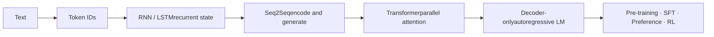

<!-- source: https://github.com/tianyi-zhang-02/cooking-agi/blob/main/00-foundations/README.en.md -->
# Learning LLMs: from tokens to generation

[中文](README.md) · **English**

> Reading time: ~7 min · Type: learning map · Last reviewed: 2026-10

I have never much liked tutorials that open with the big Transformer block diagram: every box looks familiar, yet when you actually have to walk from a piece of text to the next token, it is easy to get lost somewhere in the middle.

So this part follows the order you'd learn it in: first how text becomes numbers, then how RNNs and LSTMs handle a sequence and how Seq2Seq connects input to output, then attention and the Transformer, and finally today's decoder-only models. Examples first, then equations, then code you write yourself.

  CoreUnderstand the basic idea firstFollow the main computation and the tensor shapes, then see what problem the method solves.
  AdvancedGo further with the derivationsDerive gradients, take masks apart, and see how the training objective connects to the inference path.
  AdvancedRead model families side by sideDon't memorize model names; compare architecture, training, inference cost, and behavior by the same criteria.
  LabThen try it yourselfThe same mechanism written once in pure Python / NumPy and once in PyTorch.

To see how the whole collection fits together, start with the [study and review guide](study-guide.en.md). This page covers language-model foundations; you don't need to finish the other areas first.

## One path, end to end

  01TokenizationHow a string becomes discrete IDs the model can process
  02RNN → LSTMUse a hidden state to compress the past into one recurrent computation
  03Seq2SeqThe encoder understands the input; the decoder generates the output step by step
  04Vanilla TransformerReplace recurrence with self-attention and cross-attention
  05Decoder-only LMUnify every task as next-token prediction



## Level one: what you must know

  01 · Input<h3>Tokenization</h3>A model cannot see text. Start by watching how a sentence is split, numbered, and then turned into vectors.Read →
  02 · State<h3>RNN and LSTM</h3>If you can only read left to right, what state should hold the past? And why does a plain RNN forget so easily?Read →
  03 · Mapping<h3>Seq2Seq</h3>How one input sequence becomes an output of a different length, and why attention became a necessary mechanism.Read →
  04 · Attention<h3>Vanilla Transformer</h3>Use the 2017 original to see where the inputs of its three attention sites come from and what each one does, then understand the modern variants.Read →
  05 · Generation<h3>Decoder-only</h3>Once the prompt and the answer sit in one sequence, why a single next-token loss is enough.Read →

After reading these, try drawing the computation from text to logits without notes, explaining the input and output of each step. Wherever you get stuck is where to go back.

## Beyond the main line: two advanced routes

If similarity or a training step still feels fuzzy, read [embeddings and similarity](core/embeddings-and-similarity.en.md) and [one training step](deep-dives/training-step.en.md) first. To see how images join the same computation, continue with [CLIP → visual language models](../03-multimodal-learning/README.en.md).

Once the main line is clear, you can continue in two directions. One goes inward into equations, gradients, and execution paths. The other goes sideways across model families to compare different solutions to the same problem. They meet again at systems cost and evaluation.

### 1. Dig into mechanisms

| Topic | What you really need to understand | What you can answer afterwards |
| --- | --- | --- |
| [From linear models to neural networks](from-linear-to-neural.en.md) | Sigmoid / Softmax / ReLU / Tanh, feature maps, backpropagation, XOR | Why are the four functions not interchangeable? What does nonlinearity actually change? |
| [Sequence gradients and gates](deep-dives/recurrent-dynamics.en.md) | BPTT, Jacobian products, vanishing / exploding gradients, LSTM cell state | Why is "being able to remember" first of all an optimization problem? |
| [Attention mathematics and shapes](transformer.en.md) | $Q/K/V$, masks, multiple heads, RoPE, GQA, RMSNorm, SwiGLU | Which matrices does one attention call actually multiply? |
| [Language-model objectives and generation](deep-dives/language-model-objective.en.md) | causal loss, teacher forcing, exposure gap, sampling, cache | Training computes everything in one parallel pass; why does generation still go token by token? |

### 2. Read model families sideways

Once you know the Transformer's parts, the next step is not to memorise more model names. It is to ask: **why did this family change this component, where did the cost move, and which training and evaluation choices made the capability real?**

  Dense baseline<h3>Llama</h3>Use the modern dense decoder as a baseline: restrained architecture, with much of the story in data, scale, and the full post-training pipeline.Deep dive →
  One family, many modes<h3>Qwen</h3>See how one family spans dense and MoE models, many sizes, and thinking and non-thinking inference modes.Deep dive →
  Co-design<h3>DeepSeek</h3>Read MLA, MoE, the training system, and reasoning post-training as one cost–capability chain.Deep dive →
  Compact & multimodal<h3>Gemma</h3>Start from smaller models and deployment constraints, then connect local/global attention, distillation, and vision.Deep dive →

Start with the [model-family map](model-families/README.en.md) for the reading method. To compare exactly what changes inside the block, open the [interactive architecture map](transformer-lab.en.md#tx-arch).

## Interview quick reference

| Topic | Focus |
| --- | --- |
| [ML interview mathematics: the main line](ml-math-interview.en.md) | Softmax / CE / LSE, L1 / L2, Bias–Variance, MLE / MAP, BLUE |
| [Whiteboard hand-writing kit](hand-write-kit.en.md) | stable implementations, gradients, and numerical checks |
| [Interview basics](interview-basics.en.md) | attention, normalization, training vs. inference, Egg Drop, and tree DP |

You can skip the advanced material at first. These chapters stay because, when a model misbehaves, these details are usually exactly what you need to locate: where the gradient broke, whom the mask wrongly hid, and why training and generation fail to line up.

## Build it yourself: make the understanding run

  Without PyTorchSee where every number comes fromBPE in pure Python; RNN, LSTM, and scaled dot-product attention in NumPy.Open labs →
  With PyTorchMake the same mechanism actually learnImplement the modules yourself, use autograd, train seq2seq, and verify the Transformer's causality and KV cache.Open labs →

```bash
cd 00-foundations/code
python tokenizer_from_scratch.py
python sequence_numpy.py
python sequence_torch.py
python test_learning_path.py
```

## How to use this material

Follow the example first, then consult the equations or code where a step is unclear. You do not need to finish every part in one sitting. For a new architecture, ask which component changed, why it changed, and where the previous approach fell short.

### I just want to understand the main line first

Read core notes 01 → 05, leaving deeper derivations and code for later if useful. First understand how the methods connect, then return for details.

### I want to be able to explain it, not just to have "heard of it"

After each core node, read the matching deep-dive page and do three things: write out the central equation, label every tensor shape, and say which bottleneck of the previous generation the architecture removes.

### I want to understand a new model report

Use the six questions in the [model family deep dives](model-families/README.en.md) as your skeleton, then return to the interactive diagram to compare blocks. Do not copy the parameter table first; decide whether the real change is in architecture, training, post-training, inference, or evaluation.

### I want to write it by hand until it breaks

Run the framework-free version first, then the PyTorch version. Don't start by calling high-level APIs; if you have never handled hidden state, a causal mask, and cache positions by hand even once, a lot of bugs will all look like "training instability."

## Where this path finally leads

Only once the base model has been trained does the question move from "how does it predict the next token" to "how do we make it fit tasks, preferences, and real feedback better." The next stop is [Post-Training](../05-post-training/README.en.md); if you care about how a model finds external evidence, continue with [Search](../04-search/README.en.md).
